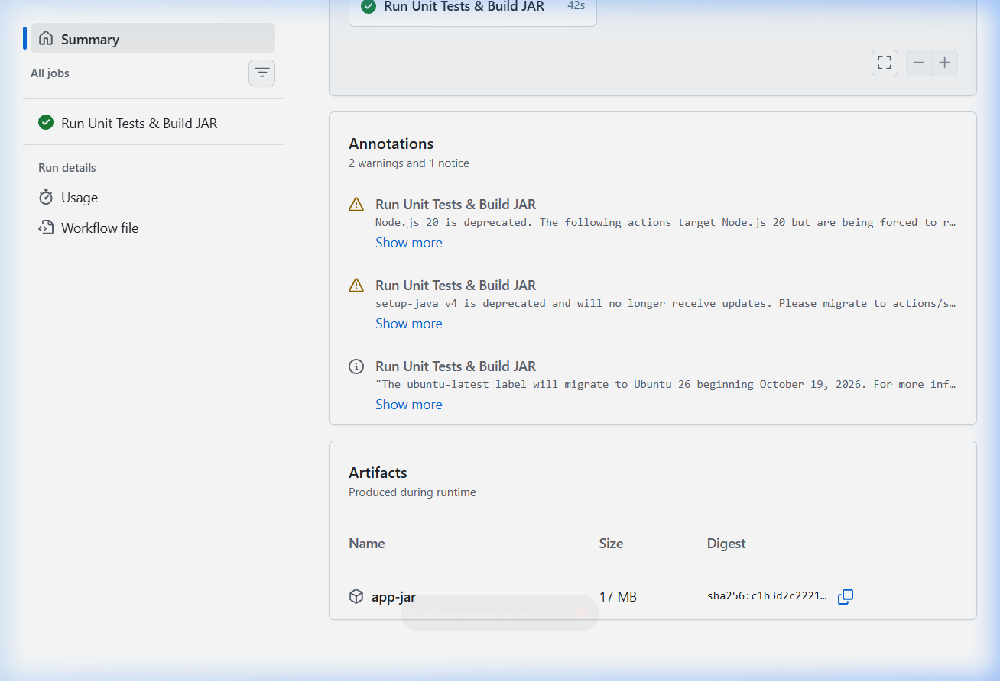

# BÁO CÁO BÀI TẬP - SESSION 11: BÀI 2

## Chủ đề: Biên dịch đóng gói tệp ứng dụng .jar với Gradle và lưu trữ Artifacts

---

## 1. Mục tiêu bài tập
- Thực thi câu lệnh biên dịch và đóng gói ứng dụng Spring Boot thành tệp thực thi `.jar` bằng Gradle Wrapper (`./gradlew bootJar`).
- Lưu trữ thành phẩm biên dịch (`.jar`) từ thư mục `build/libs/` lên GitHub Actions bằng Action `actions/upload-artifact@v4`.
- Đặt tên cho artifact là `app-jar` và cấu hình đường dẫn tệp tải lên: `build/libs/*.jar`.
- Sau khi luồng CI chạy xong trên nhánh `main`, người dùng có thể tải về tệp `.jar` trực tiếp từ phần Summary của GitHub Actions.

---

## 2. Cấu hình kịch bản GitHub Actions Workflow

Tệp cấu hình được đặt tại: `.github/workflows/ci.yml` và được sao lưu tại `homework/session_11/ex2/ci.yml`.

```yaml
name: Java Spring Boot CI (Gradle)

on:
  push:
    branches: [ "main" ]

jobs:
  test:
    name: Run Unit Tests & Build JAR
    runs-on: ubuntu-latest

    steps:
      - name: Checkout mã nguồn
        uses: actions/checkout@v4

      - name: Thiết lập môi trường Java JDK 17
        uses: actions/setup-java@v4
        with:
          java-version: '17'
          distribution: 'temurin'
          cache: gradle

      - name: Cấp quyền cho Gradle Wrapper
        run: chmod +x gradlew

      - name: Thực thi JUnit Test với Gradle
        run: ./gradlew test

      - name: Đóng gói tệp JAR với Gradle
        run: ./gradlew bootJar

      - name: Lưu trữ thành phẩm JAR Artifact
        uses: actions/upload-artifact@v4
        with:
          name: app-jar
          path: build/libs/*.jar
```

---

## 3. Giải thích chi tiết các bước trong Workflow

1. **Trigger `push` lên nhánh `main`**: Pipeline sẽ tự động kích hoạt mỗi khi có commit mới được đẩy lên nhánh chính `main`.
2. **`actions/checkout@v4`**: Tải mã nguồn của dự án về runner Ubuntu.
3. **`actions/setup-java@v4`**: Cài đặt môi trường Java 17 bản phân phối Eclipse Temurin, đồng thời kích hoạt bộ nhớ đệm (cache) cho Gradle để tăng tốc độ các lần build tiếp theo.
4. **`chmod +x gradlew`**: Cấp quyền thực thi cho script Gradle Wrapper trên hệ điều hành Linux của GitHub Runner.
5. **`./gradlew test`**: Chạy toàn bộ các bài kiểm thử tự động JUnit 5. Toàn bộ test case phải PASS thì các bước sau mới được tiếp tục.
6. **`./gradlew bootJar`**: Biên dịch toàn bộ code và đóng gói ứng dụng Spring Boot thành tệp thực thi `.jar` hoàn chỉnh nằm trong thư mục `build/libs/`.
7. **`actions/upload-artifact@v4`**:
   - `name: app-jar`: Đặt tên artifact trên GitHub Actions là `app-jar`.
   - `path: build/libs/*.jar`: Thu thập và tải lên tất cả các tệp `.jar` được tạo ra trong thư mục `build/libs/`.

---

## 4. Hướng dẫn kiểm tra và chụp ảnh màn hình nộp bài

1. Truy cập vào GitHub Repository của bạn: `https://github.com/ptitvn/IT-209-Devops-session11-bai2`
2. Nhấp vào tab **Actions**.
3. Chọn workflow run mới nhất tương ứng với commit bạn vừa đẩy lên.
4. Chờ luồng chạy hoàn tất (tất cả các bước đều có dấu tích xanh **Success**).
5. Cuộn xuống phần **Summary** (tóm tắt kết quả chạy), tại mục **Artifacts** bạn sẽ thấy xuất hiện:
   - Tên Artifact: **`app-jar`**
   - Dung lượng: khoảng ~19MB đến ~20MB
   - Có nút bấm / liên kết cho phép tải về máy tính.
6. **Chụp ảnh màn hình**:
   - Chụp toàn bộ hoặc khu vực hiển thị Workflow run thành công cùng mục **Artifacts** có chứa `app-jar`.
   - Lưu ảnh vào thư mục `homework/session_11/ex2/screenshot-artifact.png`.

---

## 5. Hình ảnh minh chứng (Artifacts)


